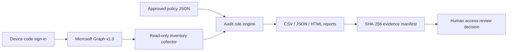

# Microsoft Entra ID Automated Identity Governance Audit

**Python · Microsoft Graph API · Microsoft Entra ID · MSAL · IAM · GRC · NIST SP 800-53**

A read-only, evidence-oriented identity governance project that inventories Microsoft Entra ID users, reviews **direct memberships** of selected security groups, identifies configurable access-review indicators, and generates a reproducible audit package (HTML, CSV, JSON, and SHA-256 manifest).

> **Status:** Offline demo + unit tests are runnable without a tenant. Live collection requires tenant authentication and permissions. Demonstration output and synthetic identities are **not real audit evidence**.

## Dashboard preview

<p align="center">
  <a href="https://github-portfolio-images.s3.us-east-1.amazonaws.com/entra-identity-governance-audit-project/Microsoft+Entra+Identity+Governance+Auditing_Tool.png">
    
  </a>
</p>

<p align="center"><em>Microsoft Entra ID Identity Governance Auditing Tool — click the screenshot to view it in full size.</em></p>

## Demonstration dashboard

Run `python main.py --demo` and open **`reports/demo/audit.html`**. You can also browse the synthetic, safe-to-share demonstration at [`docs/example-report/audit.html`](docs/example-report/audit.html).

## Project scope

- Inventory users: display name, UPN, department, job title, account enabled.
- Count all groups; audit direct membership for groups prefixed `sg-lab-`.
- Policy-driven flags for disabled user still in group, missing directory attributes, membership in a policy-designated sensitive group, overlap with other lab groups, empty groups, unknown member types, and drift from manually approved count baselines.
- Prioritize review with `MEDIUM`, `LOW`, and `INFO` (plus support for `HIGH` in reporting). **A flag is not proof of unauthorized access.**
- Produce exportable evidence with SHA-256 checksums and timestamps.
- No write permissions, no group membership changes, no tenant secrets stored in source.

### Architecture



## Local setup — Windows PowerShell + VS Code

Requires Python **3.10+**.

```powershell
# Clone your own repository, or extract this ZIP and open its folder in VS Code
cd entra-identity-governance-audit
python -m venv .venv
.\.venv\Scripts\Activate.ps1
pip install -r requirements.txt

# Offline validation; no credentials required
python -m unittest discover -s tests -v
python main.py --demo
start .\reports\demo\audit.html
```

If your shell blocks venv activation, use `.\.venv\Scripts\python.exe main.py --demo` directly. Do not disable security controls just for this lab.

### Live Microsoft Entra ID setup

1. At [entra.microsoft.com](https://entra.microsoft.com), open **Identity > Applications > App registrations > New registration**. Use a single-tenant app for this lab.
2. Record the **Application (client) ID** and **Directory (tenant) ID**.
3. Open **Authentication > Advanced settings > Allow public client flows > Yes** (required for device-code login). Device-code authentication requires an interactive user; it is not an unattended service identity.
4. Under **API permissions > Microsoft Graph > Delegated**, add `User.Read.All` and `GroupMember.Read.All`. These permissions normally require administrator consent; signed-in access and tenant policy also apply.
5. Use a test tenant / authorized tenant only. Never paste access tokens into screenshots, issues, or GitHub.

```powershell
$env:AZURE_TENANT_ID = "your-tenant-id"
$env:AZURE_CLIENT_ID = "your-app-client-id"
python main.py --live
Get-ChildItem .\reports\live -Directory | Sort-Object Name -Descending | Select-Object -First 1 | ForEach-Object { Start-Process (Join-Path $_.FullName "audit.html") }
```

You'll be asked to complete Microsoft's device-code sign-in. Each live run writes to a **UTC timestamped directory** under `reports/live/`; the script prints the exact path. This script only makes GET requests and cannot change directory memberships.

**Permissions note:** `GroupMember.Read.All` grants basic group listing and membership read; `User.Read.All` enables selected user fields. Actual access can be restricted by tenant configuration. The application should have no Graph application/write permissions for this workflow.

## Understanding the audit results

| Rule | Priority | Why it is flagged | NIST candidate mapping |
|---|---|---|---|
| `DISABLED_ACCOUNT_IN_GROUP` | Medium | Disabled user remains assigned to a lab group; **not proof they can log in** | AC-2 |
| `SENSITIVE_GROUP_MEMBER_REVIEW` | Medium | Group owner should attest members of policy-designated sensitive groups | AC-6 |
| `UNRESOLVED_USER` | Medium | Member ID cannot be matched to retrieved inventory | AC-2 |
| `CROSS_GROUP_REVIEW` | Low | Sensitive group member also belongs to a separate scoped group | AC-6 |
| `MISSING_USER_ATTRIBUTE` | Low | Policy-required identity attribute is empty | AC-2 |
| `BASELINE_COUNT_VARIANCE` / `BASELINE_MEMBER_VARIANCE` | Low | Observed counts differ from expected approved baseline | AC-2 / AC-6 |
| `EMPTY_GROUP` / `NON_USER_MEMBER` | Info | Potential cleanup or visibility limitation | AC-2 / AC-6 |

The word **sensitive** comes from `config/policy.json`. The group `sg-lab-admins` is not assumed to confer an actual Microsoft Entra administrator role. The engine does **not** evaluate effective privileged permissions.

### Baseline from the supplied lab screenshots

`config/policy.json` starts with expected counts: **8 users, 6 total groups, 5 `sg-lab-*` groups, 1 `sg-lab-admins` direct member, and 3 `sg-lab-it` direct members**. These expectations are a *dated review baseline*, not a universal truth. If you legitimately add users, update it after approval. Other group membership totals were not visible in the source screenshots and are not guessed.

### Deliverables produced per run

| Filename | Meaning |
|---|---|
| `audit.html` | Browser-ready analyst report (Print > Save as PDF if needed) |
| `audit.json` | Complete structured snapshot + metrics + findings |
| `users.csv` | User inventory |
| `groups.csv` | Group counts and direct member totals |
| `memberships.csv` | Group-to-member evidence |
| `findings.csv` | Findings review queue with recommendations |
| `evidence_manifest.json` | SHA-256 checksums of each export (integrity only, **not** proof of provenance) |

CSV fields are neutralized against formula injection before spreadsheet opening. HTML-embedded directory strings are escaped. Live reports are saved in timestamped directories in `reports/live/`, which is excluded by `.gitignore`.

## Security / audit limitations

- Scope: **direct members** only, not transitive/nested membership. Non-user objects are flagged for separate review. Microsoft Graph v1.0 has a documented service principal membership visibility limitation.
- Not checked: administrator role assignments, sign-in inactivity, Conditional Access, MFA enforcement, PIM, ownership attestations, entitlement grants, or effective application permissions.
- The output describes *review candidates*, not verified vulnerabilities, risk scores, formal findings, regulatory certification, or automatically documented control effectiveness.
- A baseline difference may be an approved change. Human validation and change-management evidence are required.
- If Graph collection fails, the run stops rather than generating a misleading complete report. Handle Microsoft Graph 429/5xx with bounded retries.
- Treat all live exports as sensitive. Limit local access, encrypt storage where appropriate, set retention, and **never publish unredacted tenant screenshots or identity reports**.
- Device-code login is interactive. Use a separately designed, explicitly authorized workload identity and app-only permission review for future scheduled production use.

## Testing

```powershell
python -m unittest discover -s tests -v
```

The suite verifies baseline metrics, risk rules, drift review, missing/unknown members, HTML escaping, CSV injection handling, pagination, retry behavior, and rejection of untrusted pagination hosts. GitHub Actions runs this suite and creates *synthetic* reports without tenant credentials.

## Roadmap

1. **MVP — complete:** Offline demo, policy-driven identity and direct membership review, report exports, retry/pagination handling, automated tests.
2. **Next:** Evidence reviewer sign-off workflow; suppression/acceptance records with expirations; snapshots diff with approved change tickets.
3. **Later:** Approved collection of real Entra role assignments and access review status, with additional permission analysis and clear evidence scope.
4. **Production-hardening:** Authenticated artifact storage, retention, audit logging, verified policy baseline approvals, CI/CD controls, operational monitoring.

## Portfolio talking points

**Problem:** Repeatedly checking identities and group membership in the portal is error prone and difficult to evidence consistently.

**Approach:** Microsoft Graph read-only collection + policy-as-code review rules + tamper-evident *checksums* on outputs + reproducible offline CI tests.

**Responsible interpretation:** A group named admins does not necessarily carry privileged directory access. A disabled user still assigned to a group can signal cleanup work without indicating an active login path.

**Success criteria:** Tests pass, demo reproduces its expected baseline, authenticated run pulls authorized directory data, output counts can be independently cross-checked against the portal, and analyst review decisions are recorded separately.

See [`docs/SCREENSHOTS.md`](docs/SCREENSHOTS.md), [`docs/CONTROL_MAPPING.md`](docs/CONTROL_MAPPING.md), [`docs/OPERATIONS.md`](docs/OPERATIONS.md), and [`docs/RESUME_BULLETS.md`](docs/RESUME_BULLETS.md).

## References

- [Microsoft Graph — list users](https://learn.microsoft.com/en-us/graph/api/user-list?view=graph-rest-1.0)
- [Microsoft Graph — list groups](https://learn.microsoft.com/en-us/graph/api/group-list?view=graph-rest-1.0)
- [Microsoft Graph — list direct group members](https://learn.microsoft.com/en-us/graph/api/group-list-members?view=graph-rest-1.0)
- [MSAL Python — device-code flow](https://learn.microsoft.com/en-us/entra/msal/python/getting-started/acquiring-tokens)
- [Microsoft Graph throttling guidance](https://learn.microsoft.com/en-us/graph/throttling)
- [NIST SP 800-53 Rev. 5](https://csrc.nist.gov/pubs/sp/800/53/r5/upd1)
